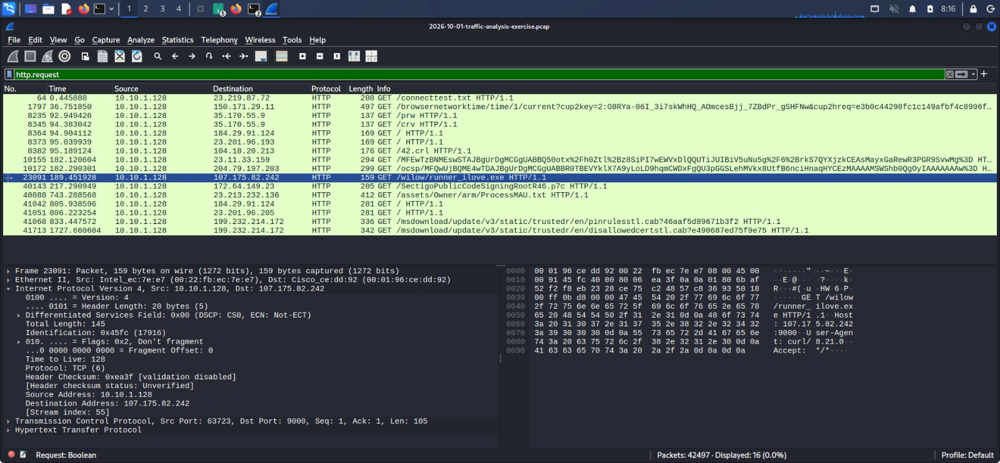
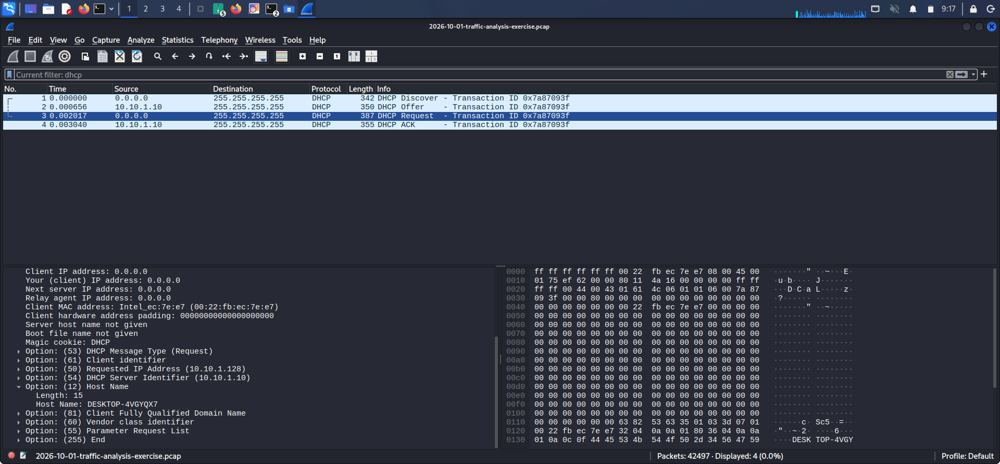
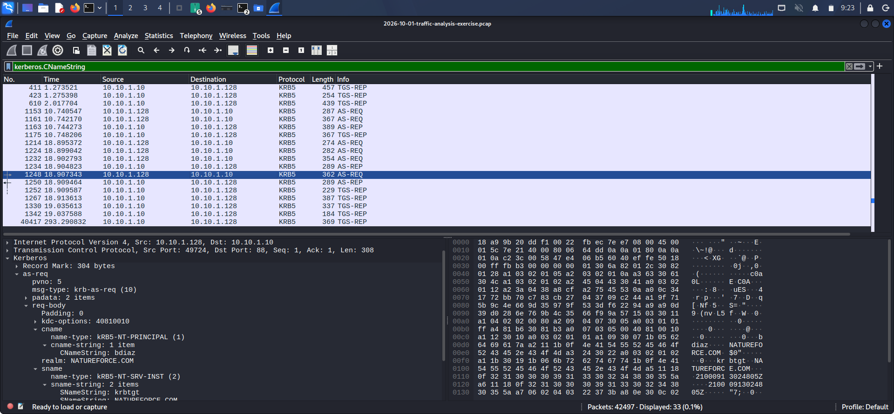

# Incident Forensic Report: Natureforce AD Compromise

# 1. Executive Summary
- **Incident Type:** Unauthorized Executable Deployment & C2 Communication
- **Target Network:** Natureforce Active Directory Domain (`natureforce.com`)
- **Impact:** Compromise of an internal workstation via unverified external payload over non-standard TCP ports.

---

## 2. Compromised Host Artifacts (IOCs)
The following forensic indicators were extracted from the network traffic capture (`.pcap`) using Wireshark and DHCP analysis:

| Indicator Category   | Forensic Value |

| **Infected Host IP** | `10.10.1.128` |
| **MAC Address**      | `00:22:fb:ec:7e:e7` |
| **Hostname**         | `DESKTOP-4V6YQX7` |
| **User Account**     | `bdiaz` |
| **C2 Destination IP**| `107.175.82.242:9000` |

### Captured Evidence
> **HTTP Payload Download & C2 Traffic:**
> 
> * **What this screenshot shows:** 
  The raw Wireshark packet capture filtering HTTP request traffic (`http.request`) initiated from the infected endpoint IP `10.10.1.128` to an external destination server (`107.175.82.242`) over TCP port `9000`.

* **Why these indicators confirm malicious C2 activity:**
  * **Unusual Executable Retrieval:** The infected host explicitly executes an HTTP GET request for `runner_jlove.exe`. Enterprise workstations rarely fetch standalone executables directly via unencrypted HTTP from untrusted public IP blocks.
  * **Non-Standard Destination Port:** Standard web traffic uses port 80 or 443. Routing unencrypted HTTP GET queries across port `9000` indicates a custom Command-and-Control staging infrastructure bypass attempt.
  * **Automated Request Behavior:** The raw packet details show synthetic User-Agent headers characteristic of automated downloader scripts rather than standard web browser interactions.
---
>
> **Host user evidence (DHCP Host Identification):**
> 
>* **What this screenshot shows:** 
  Wireshark display of DHCP protocol transactions (`dhcp` / `bootp`) capturing Option 12 (Host Name) registration streams for the assigned IP address `10.10.1.128`.

* **Why these indicators isolate endpoint `DESKTOP-4V6YQX7`:**
  * **Host Attribution:** During dynamic address negotiation, Option 12 explicitly broadcasts the client machine identifier as `DESKTOP-4V6YQX7`.
  * **Cross-Verification:** Tying `DESKTOP-4V6YQX7` directly to IP `10.10.1.128` ensures that host isolation policies and firewall blocks target the exact physical/virtual workstation involved in the breach.

---
>
>
> **User account evidence (Identity Attribution):**
> 
>* **What this screenshot shows:** 
  SMB2 and Kerberos authentication exchanges (`Kerberos` / `SMB2`) passing active session tokens originating from host IP `10.10.1.128`.

* **Why these indicators attribute the breach to account `bdiaz`:**
  * **Identity Binding:** The raw SMB Session Setup Request and Kerberos TGS/AS transactions pass the User Principal Name `bdiaz` from client host `10.10.1.128`.
  * **Operational Impact:** Confirming `bdiaz` was logged in during the execution of `runner_jlove.exe` mandates immediate Active Directory account disabling, password resets, and session revocation across the domain.

---

# 3. Malware Payload & Cryptographic Hash
The suspicious binary file (`runner_jlove.exe`) downloaded during the incident was extracted from the packet capture and analyzed:

- **Filename:** `runner_jlove.exe`
- **SHA-256 Hash:** `b789adce70c028a6d17be45ec34667aa95586350ee0c4057e75b138b1ad35061`

---
`# Verification command executed in analysis environment:`
   `sha256sum runner_jlove.exe`

---
# 4. Immediate Remediation Steps 
1. **Network Containment:** Unplug or isolate workstation `DESKTOP-4V6YQX7` from the `natureforce.com` domain immediately.
2. **Account Securing:** Revoke active tokens and force a password reset for domain user `bdiaz`.
3. **Egress Block:** Add an emergency block rule at the perimeter firewall for IP `107.175.82.242` on port `9000`.
4. **Endpoint Scans:** Run full AV/EDR triage on the host to check for scheduled tasks or registry persistence.
